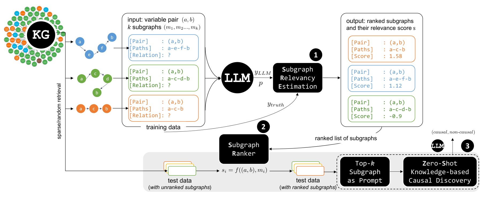
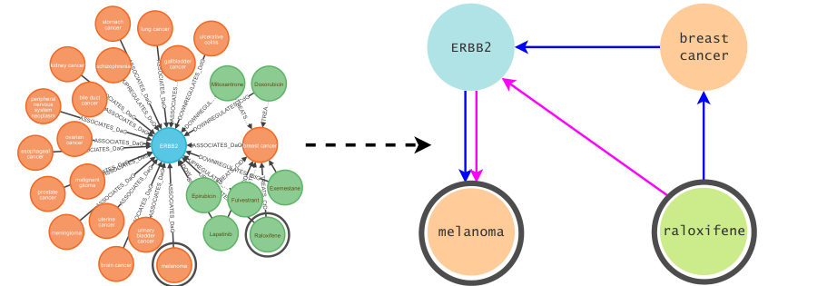
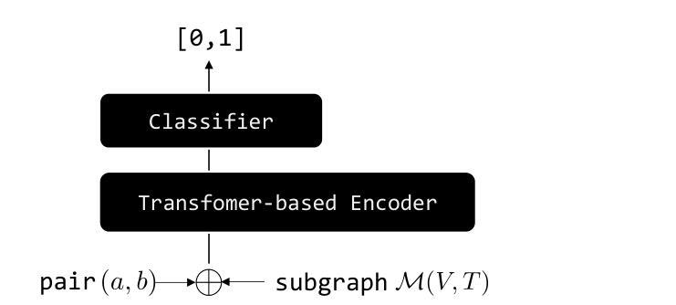
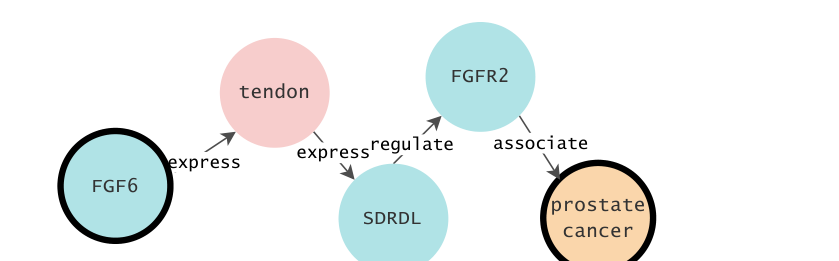
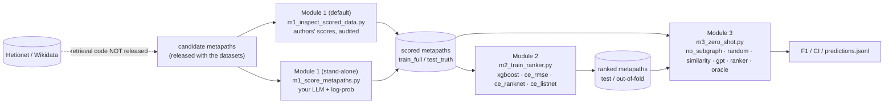

# Reproducing *Paths to Causality* (KDD '25): a modular, audited re-implementation

> **Paper:** Y. Susanti and M. Färber. *Paths to Causality: Finding Informative Subgraphs Within Knowledge Graphs for Knowledge-Based Causal Discovery.* KDD '25, Toronto. [doi:10.1145/3711896.3737076](https://doi.org/10.1145/3711896.3737076) (CC BY 4.0) ·
> **Authors' code & data:** [github.com/susantiyuni/path-to-causality](https://github.com/susantiyuni/path-to-causality) (commit [`6f9f701`](https://github.com/susantiyuni/path-to-causality/tree/6f9f701eb24bc1173581d4d6ab93e5533cf48b5e))
>
> This repository is **self-contained and independent** of the authors' code base: it re-implements the three modules of the paper as three stand-alone scripts, audits the released data and evaluation code, and compares every result with the numbers printed in the paper.
> Vietnamese reading notes on the paper: [`docs/01_paper_summary_vi.md`](docs/01_paper_summary_vi.md).

## Abstract

Knowledge-based causal discovery asks an LLM whether a pair of variables (e.g. *raloxifene*, *melanoma*) is causally related using only metadata. Susanti & Färber propose to put an *informative metapath subgraph* from a knowledge graph (KG) into the zero-shot prompt, and to learn which subgraph is informative with a Learning-to-Rank (LTR) model distilled from an LLM. We re-implement the whole pipeline — **(1) Subgraph Relevancy Estimation, (2) Subgraph Ranker, (3) Zero-shot causal discovery** — such that each module runs on its own, and evaluate it on four datasets (COMAGC, ADE, GENEC, SemEval) with two open-weight 8B LLMs served through OpenRouter.

**Main take-aways**

1. The pipeline runs end-to-end and every module is independently runnable (including a *stand-alone Module 1* that re-scores metapaths with your own LLM). It is **not a bit-for-bit reproduction**: the paper's LLMs are no longer served, the KG-retrieval and Module-1 code were never released, and the SACHS experiment (Table 3) cannot be rebuilt from the released material ([§9](#9-limitations-and-future-work)).
2. The *direction* of the paper's headline result (adding KG subgraphs helps) is only **weakly reproduced** with modern 8B LLMs: the no-subgraph baseline is already strong, a random subgraph adds **+1.7 F1** on average (paper: +12.5), and the best Subgraph Ranker beats the similarity baseline by **+3.0 F1 (best-of-4)** / **+1.1 F1 (mean of the 4 rankers)** — both inside the bootstrap noise ([§5.3](#53-module-3-vs-the-paper-protocol-a), [§5.6](#56-which-claims-reproduce)).
3. The released **ranker evaluation is mis-specified** (relevance gains are assigned in reverse; Recall@5 is constant), the released test pool is **filtered with the ground-truth labels**, and the released scores follow `±1/|log p|` rather than the paper's Eq. (1). Under a corrected metric the rankers are only marginally better than random ([§5.1](#51-audit-of-the-released-data-and-code), [§5.2](#52-module-2-subgraph-ranker)).
4. Test sets contain only **24–38 pairs**; a single pair moves F1 by 3–6 points and 95 % bootstrap intervals are ±15–25 F1. We therefore add a broader question set (protocol C, ×10–20 more pairs), prompt-paraphrase variants and confidence intervals ([§3.6](#36-evaluation-protocols-and-the-question-set), [§5.5](#55-broader-question-set-protocol-c)). On the broader set (347–838 pairs across both Llama-3.1-8B and Ministral-8B) **random, similarity and the cross-validated XGBoost ranker remain indistinguishable (within 0.1–3.6 F1, well inside the 95 % CIs)**, the context-only prompt beats or matches every subgraph option on COMAGC, ADE and GENEC, and rewording the instruction moves F1 by 8 points on average.

## Table of contents

1. [Overview](#1-overview)
2. [The original work](#2-the-original-work) — [2.1 Problem and idea](#21-problem-and-idea) · [2.2 Framework](#22-framework) · [2.3 Reported results](#23-reported-results)
3. [Methodology of this reproduction](#3-methodology-of-this-reproduction) — [3.1 Scope](#31-scope-and-component-map) · [3.2 Module 1](#32-module-1-subgraph-relevancy-estimation) · [3.3 Module 2](#33-module-2-subgraph-ranker) · [3.4 Module 3](#34-module-3-zero-shot-knowledge-based-causal-discovery) · [3.5 Metrics](#35-metrics) · [3.6 Protocols & question set](#36-evaluation-protocols-and-the-question-set)
4. [Experimental setup](#4-experimental-setup) — [4.1 Datasets](#41-datasets) · [4.2 Models](#42-models-and-substitutions) · [4.3 Hyper-parameters](#43-hyper-parameters) · [4.4 Hardware](#44-hardware-and-run-times)
5. [Results](#5-results) — [5.1 Audit](#51-audit-of-the-released-data-and-code) · [5.2 Module 2](#52-module-2-subgraph-ranker) · [5.3 Module 3 vs. paper](#53-module-3-vs-the-paper-protocol-a) · [5.4 No label leak](#54-label-leak-free-protocol-b) · [5.5 Broader question set](#55-broader-question-set-protocol-c) · [5.6 Which claims reproduce?](#56-which-claims-reproduce)
6. [Differences from the original](#6-differences-from-the-original)
7. [How to run](#7-how-to-run) — [7.1 Requirements](#71-requirements) · [7.2 Install](#72-installation) · [7.3 Authors' data](#73-get-the-authors-data) · [7.4 API keys](#74-api-keys) · [7.5 Quick start](#75-quick-start) · [7.6 Everything](#76-run-everything) · [7.7 Modules](#77-run-modules-independently) · [7.8 Stand-alone Module 1](#78-stand-alone-module-1) · [7.9 Logs & outputs](#79-logs-timestamps-and-outputs) · [7.10 Time & cost](#710-time-and-cost) · [7.11 Troubleshooting](#711-troubleshooting)
8. [Repository layout](#8-repository-layout)
9. [Limitations and future work](#9-limitations-and-future-work)
10. [Citation and credits](#10-citation-and-credits)

---

## 1. Overview

| Question | Answer |
|---|---|
| What is reproduced? | The three modules of the paper, the four datasets, the four rankers (RoBERTa-RMSE/RankNet/ListNet cross-encoders, XGBoost), the five baselines (no-subgraph, random, similarity, GPT-based, oracle) and the F1 / NDCG@5 / Recall@5 evaluation. |
| What is new? | (i) every module runs independently; (ii) **stand-alone Module 1** that scores metapaths with your own LLM instead of using the authors' scores; (iii) audit of released data/evaluation code with *paper-style* **and** *corrected* metrics; (iv) leak-free pool protocol; (v) larger question set via cross-validated rankers; (vi) prompt-paraphrase variants and bootstrap CIs; (vii) time-stamped logs, results and model weights. |
| What is *not* reproduced? | KG retrieval from Hetionet/Wikidata, the authors' own Module-1 run (mistral-7b-instruct-v0.1), SACHS (Table 3), the three original LLMs (two modern substitutes are used). See [§9](#9-limitations-and-future-work). |
| Where are the numbers? | [§5](#5-results); machine-generated snapshots in [`docs/results/`](docs/results/) (regenerated into `outputs/COMPARISON*.md`, `outputs/SUMMARY.md`). |

## 2. The original work

### 2.1 Problem and idea

*Pairwise knowledge-based causal discovery*: given variables *(a, b)* and optionally a context sentence, predict `causal` / `non-causal` from metadata only. LLMs alone are unstable and hallucinate; KGs (Hetionet for biomedicine, Wikidata for open domain) offer structured evidence, but between two nodes there are hundreds of paths (e.g. 32 one-hop and 1,031 two-hop paths between *raloxifene* and *melanoma*). The paper therefore (1) lets an LLM judge how informative each **metapath** is, (2) **distils** that judgement into a ranker, and (3) puts the top-*k* (*k* = 1 works best) metapath into a zero-shot prompt.

### 2.2 Framework

<p align="center"></p>

*Figure 1 — Overview of the approach: ① Subgraph Relevancy Estimation, ② Subgraph Ranker, ③ zero-shot knowledge-based causal discovery. Reproduced from Figure 2 of Susanti & Färber (KDD '25), CC BY 4.0.*

<table align="center"><tr>
<td align="center"><br><sub><b>Figure 2</b> — Two metapaths between <i>raloxifene</i> and <i>melanoma</i> (paper Fig. 3).</sub></td>
<td align="center"><br><sub><b>Figure 3</b> — Cross-encoder Subgraph Ranker (paper Fig. 4).</sub></td>
<td align="center"><br><sub><b>Figure 4</b> — A subgraph verbalised as a prompt (paper Fig. 5).</sub></td>
</tr></table>

| Module | Input → output | Method in the paper |
|---|---|---|
| ① Subgraph Relevancy Estimation (§4.2, App. C) | pair + **one** metapath → relevance score | `mistral-7b-instruct` predicts `causal/non-causal`; a metapath is *relevant* if the prediction equals the human label; score derived from the token log-probability; metapaths ranked per pair (≤ 10). |
| ② Subgraph Ranker (§4.3, App. D) | pair + metapaths → ranking | Cross-encoder (`roberta-base`) trained with pointwise **RMSE**, pairwise **RankNet** or listwise **ListNet** (allRank); or **XGBoost** `rank:ndcg` on 128-d embeddings of a 2-gram LM. |
| ③ Zero-shot KBCD (§4.4, App. E) | `[instruction][context][top-k metapath] The relation between a and b is` → label | Greedy decoding with `mistral-7b-instruct`, `llama-3-8b-instruct`, `gemma-7b-it`; *k* = 1. |

### 2.3 Reported results

* Tables 1–2: F1 of eight selection strategies (no-subgraph, random, similarity, GPT-based, four Subgraph Rankers) × three LLMs × four datasets; headline: up to **+44.4 F1** over no-subgraph, **+12.5** for random over no-subgraph on average, **+7.74** over similarity.
* Table D2: ranker NDCG@5 ≈ 55–57 / Recall@5 = 71.43 on COMAGC (≈ 89–92 / 100 on SemEval).
* Table 3: SACHS protein graph — F1 77.42 vs 44.00 (PC), HD 7 vs 24.

## 3. Methodology of this reproduction

### 3.1 Scope and component map



| Paper component | Authors' repo | This repo | Status |
|---|---|---|---|
| KG retrieval (Neo4j / CLOCQ) | not released | uses the released candidate paths | released subset only |
| Module 1 scores | `datasets/*/{train_full,test_truth}.jsonl` | [`m1_inspect_scored_data.py`](m1_inspect_scored_data.py) (audit) · [`m1_score_metapaths.py`](m1_score_metapaths.py) (**re-score**) | ✔ / ✔ (smoke-tested at small scale) |
| Module 2 cross-encoders | `src/ltr_nn.py`, `rank_loss.py` | [`m2_train_ranker.py`](m2_train_ranker.py), [`lib/rankers.py`](lib/rankers.py) | ✔ |
| Module 2 XGBoost | `src/ltr_xgboost.py` | same script (bug-fixed re-write) | ✔ |
| Module 2 metrics | `src/ltr_eval.py`, `dt_utils.py` | [`lib/metrics.py`](lib/metrics.py), [`m2_eval_ranked.py`](m2_eval_ranked.py) | ✔ (paper-style + corrected) |
| Module 3 | `src/instruct.py`, `zero_templatizer.py`, `llm.py` | [`m3_zero_shot.py`](m3_zero_shot.py), [`lib/prompts.py`](lib/prompts.py), [`lib/llm.py`](lib/llm.py), [`lib/selection.py`](lib/selection.py) | ✔ |
| RankGPT baseline | `src/rank_gpt.py`, `ltr_gpt.py` (not runnable) | [`tools/rankgpt_rerank.py`](tools/rankgpt_rerank.py) | ✔ (re-run) / released file |

### 3.2 Module 1: Subgraph Relevancy Estimation

Two interchangeable ways to obtain scored metapaths (same JSONL schema, so Module 2 and 3 do not care which one is used):

**(a) Use the authors' scores (default)** — [`m1_inspect_scored_data.py`](m1_inspect_scored_data.py) loads `data/authors/datasets/<task>/{train_full,test_truth}.jsonl`, verifies them and writes `outputs/module1/report.md`. No LLM is called.

**(b) Stand-alone Module 1 (no author scores)** — [`m1_score_metapaths.py`](m1_score_metapaths.py), see [§7.8](#78-stand-alone-module-1):

1. Candidates = pairs + metapaths (`stops`, `reltypes`, `nodelabels`). Every score the authors computed (`rel_score`, `prob_score`, `relevant`) is **stripped before use** ([`lib/relevancy.py::strip_scores`](lib/relevancy.py)). You may pass your own candidates with `--input-dir`.
2. One prompt per (pair, metapath): the paper's `tcma` template with *k* = 1 (`[Pair] … [Context sentence] … [Relation paths] … [Relation]:`).
3. The LLM's label is compared with the human label → `relevant` ∈ {"1","0"}.
4. `prob_score` = log-probability of the token that decides the label. `--logp-mode authors` (default) copies the authors' `inference_with_score`: first generated token in `{non,false,negative,no,neg,fal}` ∪ `{caus,aus,true,positive,yes,pos,tru}`, otherwise the first token. Alternatives: `first_token`, `label_tokens` (sum over the label's tokens).
5. `rel_score`: `--score-formula authors` (default) = **+1/|log p| if correct, −1/|log p| if wrong** — the formula that holds for **12,623 / 12,623** released metapaths and for the paper's own Appendix-C example (`probscore = −0.7063895` → `relscore = 1.41565`); `eq1_prob` (1 ± p) and `eq1_logprob` implement Eq. (1) as printed.
6. Metapaths of each pair are sorted by `rel_score` (descending) → `train_full.jsonl` / `test_truth.jsonl` under `outputs/module1/rescored/<tag>_<timestamp>/<task>/`, plus `meta.json`, `report.md` (LLM accuracy, agreement with the authors' flags/ranking).

Back-ends: `openai` (any OpenAI-compatible API **that returns log-probs**; on OpenRouter use `mistralai/mistral-nemo` — we verified it returns full token log-probs, whereas `meta-llama/llama-3.1-8b-instruct` returns only the stop token and `ministral-8b-2512` has no log-prob provider; the script validates this and fails loudly), `hf` (local `transformers`, exactly the paper's way) and `mock`.

### 3.3 Module 2: Subgraph Ranker

* **Cross-encoder** (`ce_rmse`, `ce_ranknet`, `ce_listnet`): `roberta-base` + 1-logit head, input `[CLS] a b [SEP] type₁ v₁ - type₂ v₂ …`; losses implemented from allRank semantics; padding ignored in the loss.
* **XGBoost** (`xgboost`): 2-gram neural LM (embedding 128-d) trained from scratch on `pair + metapath` text → mean-pooled embedding → `XGBRanker(rank:ndcg, hist, lambdarank_pair_method=topk, num_pair_per_sample=8)`.
* Epoch selection on a **dev split of the training set** (the authors select on the test set).
* `--cv-folds K` produces **out-of-fold** rankings of *all* pairs for the broad evaluation (protocol C).
* Weights are saved to `outputs/module2/<task>/<tag>/model_<timestamp>/` (XGBoost always; cross-encoders with `--save-model`).

### 3.4 Module 3: Zero-shot knowledge-based causal discovery

[`m3_zero_shot.py`](m3_zero_shot.py) builds one prompt per pair with the authors' template ([`lib/prompts.py`](lib/prompts.py)) and one of these **selection options** ([`lib/selection.py`](lib/selection.py)):

| Option | Meaning | Paper counterpart |
|---|---|---|
| `no_subgraph_pair` / `no_subgraph` | pair only / pair + context sentence | *no-subgraph* |
| `random[:seed]` | random metapath from the pool (3 seeds) | *random* |
| `similarity` / `similarity_recompute` | MiniLM cosine: authors' file / recomputed on the same pool | *similarity-based* |
| `gpt` / `gpt_rerank` | RankGPT: authors' file (gpt-3.5) / re-run with your API (shuffled input) | *GPT-based* |
| `ranker:<tag>` | top-1 of **your** Module 2 (`xgboost`, `ce_rmse`, `ce_ranknet`, `ce_listnet`) | *Subgraph Ranker* |
| `authors_ranker:<name>` | top-1 of the authors' released rankings | *Subgraph Ranker* |
| `oracle` | best `rel_score` (sees labels) | upper bound only |

Labels are parsed twice and both F1 values are reported: the authors' verbalizer (substring `no` checked first, so `"causal. Knowledge…"` counts as non-causal) and a robust parser (earliest label wins). Raw outputs are stored per question in `predictions.jsonl`.

### 3.5 Metrics

* **Module 3:** precision / recall / **F1** of the `causal` class, accuracy, 95 % **bootstrap** confidence intervals (1,000 resamples), `unparsed` and `#pred causal` counters (guard against collapsed outputs).
* **Module 2:** `paper_style_*` replicates the authors' evaluation exactly (it reproduces their logged NDCG@5, e.g. 0.56595); `corrected_*` gives the best metapath the highest gain, plus Top-1 hit, overlap@k and the oracle rank of the top-1 ([§5.1](#51-audit-of-the-released-data-and-code)).

### 3.6 Evaluation protocols and the question set

**Is "one pair = one question, answer causal/non-causal" the paper's protocol? Yes.** The task is binary classification of a variable pair; each test instance is one zero-shot prompt (§4.4.3, Eq. 8) and the metric is P/R/F1 over the test split. The test splits after filtering to pairs that have KG paths are tiny (COMAGC 34, ADE 38, GENEC 35, SemEval 24 pairs; ADE contains only positives). That is why the console shows one summary line per (dataset, option) — and, in `--dry-run`, one sample prompt — while the log file and `predictions.jsonl` contain every question and answer. The paper does not vary the instruction wording or report intervals. To obtain a broader and more reliable question set this repo offers, **without changing the task**:

| Protocol | Pairs per dataset | Pool of candidate metapaths | Rankers | Purpose |
|---|---|---|---|---|
| **A** `--pool oracle_top5` (default) | test: 24–38 | first 5 of `test_truth` — *already filtered with the labels* | trained on train | the paper's protocol; compare with Tables 1–2 |
| **B** `--pool all` | test: 24–38 | all candidates — **no label leak** | trained on train | honest estimate |
| **C** `--eval-split full` | **all** pairs: 347–838 (train+test, ×10–20) | all candidates | **5-fold out-of-fold** (`m2 --cv-folds 5`) | statistically meaningful comparison |
| *prompt variants* `--prompt-variants 0 1 2 3 4` | any | any | any | sensitivity to the instruction wording (0 = paper's) |

A zero-shot LLM is never trained, so scoring it on training-split pairs is valid; only the *rankers* need out-of-fold scores, which `--cv-folds` provides. Files that exist only for the test split (`similarity`, `gpt`, `authors_ranker:*`) are skipped under protocol C (use `similarity_recompute`, `gpt_rerank`, `ranker:*`). Note that F1 depends on class prevalence: the full set is more negative-heavy than the test split, so F1 under protocol C is *not* comparable to protocol A numbers in absolute terms — compare options *within* a protocol.

## 4. Experimental setup

### 4.1 Datasets

| Dataset | Domain / KG | Instances in paper (Table A1) | Pairs with ≥ 1 metapath: train / test | Metapaths (train+test) | Test causal rate |
|---|---|---:|---|---:|---:|
| COMAGC | gene–disease / Hetionet | 820 | 638 / 34 | 3,323 | 0.50 |
| ADE | drug–side effect / Hetionet | 6,821 | 800 / 38 | 5,333 | 1.00 |
| GENEC | gene–gene / Hetionet | 789 | 517 / 35 | 2,804 | 0.51 |
| SemEval-2010 T8 | open domain / Wikidata | 10,717 | 323 / 24 | 1,163 | 0.50 |

Source: the files released by the authors (fetched with [`tools/fetch_authors_data.py`](tools/fetch_authors_data.py), SHA-256-verified). Up to 10 metapaths per pair.

### 4.2 Models and substitutions

| Role | Paper | This reproduction | Reason |
|---|---|---|---|
| LLM (Module 3) | `mistral-7b-instruct`, `llama-3-8b-instruct`, `gemma-7b-it` (local, raw prompt, greedy, 6 tokens) | `meta-llama/llama-3.1-8b-instruct`, `mistralai/ministral-8b-2512` via **OpenRouter** (chat endpoint, *T* = 0, 8 tokens, system prompt + one-word suffix) | the paper's models are no longer served by OpenRouter; raw chat models ramble (Llama-3.1 answers "Based on the given information…" → 100 % unparsed without the suffix) |
| LLM (Module 1) | `mistral-7b-instruct` local | released scores (default) or `mistral-nemo` / any HF model (stand-alone) | Module-1 code not released |
| Cross-encoder | `roberta-base` | `roberta-base` | same |
| Similarity | `all-MiniLM-L6-v2` | `all-MiniLM-L6-v2` | same (formula reproduced to 0.0000 on the 3 biomedical sets) |
| GPT ranker | `gpt-3.5-turbo-instruct`, oracle-ordered input | authors' file (A) · `openai/gpt-4o-mini`, shuffled input (B) | the original script cannot run; shuffling removes the order leak |

### 4.3 Hyper-parameters

Cross-encoder: AdamW, lr 5·10⁻⁵, 10 epochs, 8 pairs per step, 5 training metapaths per pair (`--neg-num`), max length 500, dev split 10 % for epoch selection. XGBoost: `hist`, `rank:ndcg`, `lambdarank_num_pair_per_sample=8`, `lambdarank_pair_method=topk` (paper Table D3), 100 trees; 2-gram LM, embedding 128, 10 epochs. Seeds: 1111 (rankers), 1/2/3 (random selection). Decoding: temperature 0.

### 4.4 Hardware and run times

Windows 11, Intel i7-14700K, NVIDIA RTX 4070 Ti SUPER 16 GB, Python 3.14.7, PyTorch 2.14.1+cu126, Transformers 5.22.1, XGBoost 3.4.1 (the paper used 2×Tesla P100, CUDA 10.2). Measured: XGBoost 0.7–5.6 s per dataset; cross-encoders 28–84 s per (dataset, loss) → **≈ 11 min** for all 12; Module 3 ≈ 4–6 API calls/s. See [§7.10](#710-time-and-cost).

## 5. Results

<!-- AUTO:status -->
_Latest experimental runs included in this report (updated 2026-11-04T23:51:38+07:00):_

| Source | Time (run start / last training) | Run |
|---|---|---|
| Module 3 (`test`, pool `all`) | 2026-11-04T20:01:45+07:00 | `or_llama-3.1-8b-instruct_chat_all_k1_pv` |
| Module 3 (`test`, pool `oracle_top5`) | 2026-11-04T23:12:39+07:00 | `or_llama-3.1-8b-instruct_chat_oracle_top5_k1` |
| Module 3 (`test`, pool `all`) | 2026-11-04T23:12:40+07:00 | `or_llama-3.1-8b-instruct_chat_all_k1` |
| Module 3 (`full`, pool `all`) | 2026-11-04T23:12:40+07:00 | `or_llama-3.1-8b-instruct_chat_all_k1_full` |
| Module 3 (`test`, pool `all`) | 2026-11-04T23:12:41+07:00 | `or_ministral-8b-2512_chat_all_k1` |
| Module 3 (`full`, pool `all`) | 2026-11-04T23:12:41+07:00 | `or_ministral-8b-2512_chat_all_k1_full` |
| Module 3 (`test`, pool `oracle_top5`) | 2026-11-04T23:12:41+07:00 | `or_ministral-8b-2512_chat_oracle_top5_k1` |
| Module 2 (16 task × ranker runs) | 2026-11-04T23:11:38+07:00 | oldest: 2026-11-04T23:01:15+07:00 |
<!-- /AUTO:status -->

> **Provenance.** All Module 2 and Module 3 runs (protocols A, B and C on both Llama-3.1-8B-Instruct and Ministral-8B-2512, 5-fold out-of-fold XGBoost rankings, and the 5-paraphrase prompt-sensitivity study) were executed and verified on 2026-11-04 (logs in `logs/`). Not run at full scale: stand-alone Module 1 on all 12,623 metapaths (smoke-tested on 74 COMAGC pairs) and cross-validated cross-encoders. The table above lists every run behind the results below.

### 5.1 Audit of the released data and code

Reproduce with `python m1_inspect_scored_data.py` and `python m2_eval_ranked.py --authors`.

1. **Scores follow `±1/|log p|`, not Eq. (1).** 12,623 / 12,623 released metapaths satisfy `rel_score = +1/|prob_score|` (relevant) or `−1/|prob_score|` (not); none satisfy `1 ± p`. The paper's own Appendix-C example agrees (1/0.7063895 = 1.41565).
2. **Ranker NDCG is computed with reversed gains.** In `dt_utils.write_file(..., is_truth=True)` the ground-truth "relevance" of a metapath is its *rank* (best = 1) and `pytrec_eval` treats larger numbers as more relevant. Our re-implementation reproduces their logged NDCG@5 exactly. COMAGC NDCG@5 (paper-style): oracle ordering **0.459** < random **0.547** < reversed-oracle **0.635**; the paper's 0.55–0.57 equals random. With SemEval a fully reversed ranking scores 1.0.
3. **Recall@5 is constant** (every metapath is "relevant" ⇒ `min(5,n)/n` = 71.43 % COMAGC, ≈ 72.2 % ADE, 100 % SemEval) and therefore independent of the ranker.
4. **The pool is filtered with the labels.** `test_truth` is sorted by `rel_score`, which depends on whether the LLM matched the human label, and only its first 5 metapaths are re-ranked. P(LLM correct | metapath kept) vs dropped: 0.688 vs 0.676 (COMAGC), **0.473 vs 0.311 (ADE)**, 0.543 vs 0.522 (GENEC).
5. **Under a corrected metric the authors' released rankers are near random.** COMAGC top-1 equals the oracle's top-1 in 5.9 / 5.9 / 11.8 % (RMSE/RankNet/ListNet) and 11.8 % (XGBoost) vs 20 % random; the released RankGPT ranking reaches 35.3 %.
6. **Other findings:** the authors' verbalizer mis-labels `"causal. Knowledge…"`; their XGBoost code uses position as label (0 = best, but XGBoost treats larger as better) and indexes by `qid`; model selection uses the test set; `ltr_gpt.py`/`instruct_gpt.py` do not run as shipped.

### 5.2 Module 2: Subgraph Ranker

**vs. Table D2** (NDCG@5, %, `roberta-base`; "paper-style" = authors' metric; "corrected" = best path has highest gain, pool = 5 first paths):

<!-- AUTO:d2 -->
| Dataset | Loss | Paper NDCG@5 | Ours paper-style | Ours corrected | Random (corrected) | Paper / ours Recall@5 |
|---|---|---:|---:|---:|---:|---|
| COMAGC | rmse | 56.60 | 56.80 | 82.81 | 86.05 | 71.43 / 71.43 |
| COMAGC | ranknet | 57.12 | 54.00 | 87.22 | 86.05 | 71.43 / 71.43 |
| COMAGC | listnet | 55.38 | 53.90 | 87.38 | 86.05 | 71.43 / 71.43 |
| ADE | rmse | 57.61 | 56.10 | 86.16 | 86.50 | 72.18 / 72.18 |
| ADE | ranknet | 55.54 | 54.72 | 88.33 | 86.50 | 72.18 / 72.18 |
| ADE | listnet | 56.64 | 55.04 | 87.84 | 86.50 | 72.18 / 72.18 |
| GENEC | rmse | 56.79 | 55.41 | 85.51 | 86.07 | 71.77 / 71.77 |
| GENEC | ranknet | 55.89 | 55.76 | 85.08 | 86.07 | 71.77 / 71.77 |
| GENEC | listnet | 55.52 | 56.24 | 84.33 | 86.07 | 71.77 / 71.77 |
| SEMEVAL | rmse | 91.92 | 88.76 | 87.61 | 88.18 | 100.00 / 100.00 |
| SEMEVAL | ranknet | 89.42 | 85.92 | 90.46 | 88.18 | 100.00 / 100.00 |
| SEMEVAL | listnet | 88.99 | 89.16 | 87.21 | 88.18 | 100.00 / 100.00 |
<!-- /AUTO:d2 -->

Reading: the paper-style NDCG@5 we obtain (53.9–56.8 on the three biomedical sets) is within ≈ 3 points of the paper (largest gap: COMAGC RankNet, 3.1) — the training pipeline reproduces — yet the same models are **indistinguishable from random** under the corrected metric (mean Δ NDCG@5 vs. random over the four datasets: XGBoost +0.011, RankNet +0.006, ListNet +0.003, RMSE −0.005; Top-1 hit XGBoost 0.32, RankNet/ListNet 0.25, RMSE 0.21 vs 0.225 random). SemEval's paper figure (≈ 89–92) is higher than our 86–88; we could not trace the cause (checkpoint/epoch differences are likely).

**Out-of-fold XGBoost on all pairs** (5-fold, `m2_train_ranker.py --rankers xgboost --cv-folds 5`; corrected metric; avoids the 24–38-pair test noise):

<!-- AUTO:cv_xgb -->
| Dataset | Pairs | NDCG@5 (pool top-5) | Random | Top-1 hit | Random | NDCG@5 (pool all) |
|---|---:|---:|---:|---:|---:|---:|
| COMAGC | 672 | 0.872 | 0.866 | 0.257 | 0.230 | 0.867 |
| ADE | 838 | 0.885 | 0.872 | 0.314 | 0.262 | 0.780 |
| GENEC | 552 | 0.870 | 0.862 | 0.266 | 0.207 | 0.862 |
| SemEval | 347 | 0.912 | 0.902 | 0.455 | 0.401 | 0.912 |
<!-- /AUTO:cv_xgb -->

The ranker is consistently — but only slightly — better than random (+0.006 … +0.013 NDCG@5; +2.7 … +5.9 points Top-1 hit). Recovering *which metapath made the LLM right* from the metapath text alone is hard.

### 5.3 Module 3 vs. the paper (protocol A)

F1 (%) averaged over LLMs: **paper** = mistral-7b / llama-3-8b / gemma-7b (Tables 1–2), **ours** = Llama-3.1-8B / Ministral-8B (OpenRouter, chat). Same protocol (A): test split, first-5 pool, *k* = 1. Per-LLM tables: [`docs/results/COMPARISON.md`](docs/results/COMPARISON.md) (snapshot; regenerate with `python tools/compare_with_paper.py`, which also writes `outputs/COMPARISON.md`).

<!-- AUTO:summary_A -->
_LLM of this repo: llama-3.1-8b-instruct, ministral-8b-2512. Cells: paper / ours (F1 %)._

| method | COMAGC paper / ours | ADE paper / ours | GENEC paper / ours | SEMEVAL paper / ours | **avg paper / ours** |
|---|---|---|---|---|---|
| no-subgraph (pair only) | 46.2 / 61.1 | 66.6 / 95.2 | 33.8 / 52.6 | 50.9 / 66.5 | **49.4 / 68.8** |
| random | 68.4 / 78.2 | 79.5 / 87.8 | 40.4 / 45.0 | 59.2 / 70.9 | **61.9 / 70.5** |
| similarity (MiniLM) | 69.6 / 78.1 | 82.0 / 86.7 | 42.0 / 43.2 | 64.7 / 72.0 | **64.6 / 70.0** |
| GPT-based (RankGPT) | 79.0 / 78.1 | 83.8 / 87.8 | 44.8 / 51.5 | 62.8 / 72.0 | **67.6 / 72.3** |
| Ranker: RoBERTa-RMSE | 76.8 / 78.1 | 83.6 / 89.6 | 44.7 / 45.0 | 67.7 / 70.9 | **68.2 / 70.9** |
| Ranker: RoBERTa-RankNet | 78.1 / 77.6 | 85.7 / 87.6 | 52.8 / 48.9 | 62.1 / 73.6 | **69.7 / 71.9** |
| Ranker: RoBERTa-ListNet | 75.8 / 75.6 | 84.4 / 89.6 | 49.7 / 49.6 | 61.4 / 70.9 | **67.8 / 71.5** |
| Ranker: XGBoost | 74.8 / 77.3 | 83.7 / 87.1 | 42.1 / 44.9 | 64.6 / 70.9 | **66.3 / 70.0** |
<!-- /AUTO:summary_A -->

Observations (details in [§5.6](#56-which-claims-reproduce)):

* Our modern LLMs have a **much stronger no-subgraph baseline** (68.8 vs 49.4 average F1; ADE 95.2 vs 66.6) — there is little headroom left for KG evidence.
* Subgraphs still help on COMAGC and on average, but the gain is smaller and not uniform; on ADE a *random* metapath **lowers** Ministral's F1 from 95.9 to ≈ 81.
* Differences between the seven subgraph-based methods are ≤ 2.3 F1 on average (70.0 – 72.3) — far inside the 95 % bootstrap interval of a single cell (e.g. COMAGC, Llama: random 80.9 [65, 92], similarity 77.3 [61, 89], XGBoost 75.6 [59, 88]; GENEC no-subgraph 38.5 [10, 61]).

### 5.4 Label-leak-free protocol (B)

Same models and metrics, but the whole candidate pool (`--pool all`) is ranked and the label-filtered files of the authors are replaced by `similarity_recompute` and a re-run `gpt_rerank` (gpt-4o-mini, shuffled input). Average F1 over our two LLMs and four datasets: no-subgraph (pair + context) 72.6, random 70.6, similarity 71.0, GPT 71.6, RMSE 70.7, **RankNet 72.4**, ListNet 70.8, XGBoost 70.2 ([`docs/results/COMPARISON_all.md`](docs/results/COMPARISON_all.md)). Without the label-filtered pool the best-of-4 ranker's advantage over similarity shrinks from +2.95 to **+2.46** and the mean-of-4 advantage to **+0.01**; a random subgraph is now *worse* than no subgraph (−2.0 F1).

<!-- AUTO:summary_B -->
_LLM of this repo: llama-3.1-8b-instruct, ministral-8b-2512. Cells: paper / ours (F1 %)._

| method | COMAGC paper / ours | ADE paper / ours | GENEC paper / ours | SEMEVAL paper / ours | **avg paper / ours** |
|---|---|---|---|---|---|
| no-subgraph (pair + context) | 46.2 / 75.0 | 66.6 / 95.2 | 33.8 / 46.8 | 50.9 / 73.2 | **49.4 / 72.6** |
| random | 68.4 / 78.7 | 79.5 / 88.0 | 40.4 / 44.7 | 59.2 / 70.9 | **61.9 / 70.6** |
| similarity (MiniLM) | 69.6 / 76.2 | 82.0 / 88.8 | 42.0 / 47.0 | 64.7 / 72.0 | **64.6 / 71.0** |
| GPT-based (RankGPT) | 79.0 / 78.0 | 83.8 / 90.4 | 44.8 / 47.0 | 62.8 / 70.9 | **67.6 / 71.6** |
| Ranker: RoBERTa-RMSE | 76.8 / 79.0 | 83.6 / 90.5 | 44.7 / 42.2 | 67.7 / 70.9 | **68.2 / 70.7** |
| Ranker: RoBERTa-RankNet | 78.1 / 80.5 | 85.7 / 87.6 | 52.8 / 47.7 | 62.1 / 73.6 | **69.7 / 72.4** |
| Ranker: RoBERTa-ListNet | 75.8 / 75.4 | 84.4 / 90.5 | 49.7 / 46.4 | 61.4 / 70.9 | **67.8 / 70.8** |
| Ranker: XGBoost | 74.8 / 77.3 | 83.7 / 86.9 | 42.1 / 45.6 | 64.6 / 70.9 | **66.3 / 70.2** |
<!-- /AUTO:summary_B -->

### 5.5 Broader question set (protocol C)

Evaluated with both **Llama-3.1-8B-Instruct** and **Ministral-8B-2512** (`--pool all --eval-split full`, `ranker:xgboost` = 5-fold out-of-fold ranking): the question set grows from 24–38 to **347–838 pairs per dataset** (runs `or_llama-3.1-8b-instruct_chat_all_k1_full` and `or_ministral-8b-2512_chat_all_k1_full`). The always-`causal` F1 is shown as a trivial reference because the full sets are far more negative-heavy than the test splits (causal rate 0.09–0.21 vs ≈ 0.5), so absolute F1 is **not comparable** with §5.3 — compare rows within a dataset.

<!-- AUTO:protocol_c -->
**llama-3.1-8b-instruct** (`or_llama-3.1-8b-instruct_chat_all_k1_full`)

| Dataset (pairs, causal rate → always-causal F1) | Option | P | R | F1 [95 % CI] | Acc |
|---|---|---|---|---|---|
| COMAGC (672, 0.21 → 34.3) | no_subgraph (+ context) | 24.9 | 97.1 | 39.6 [35, 44] | 38.8 |
|  | random(3 seeds) | 24.4 | 97.6 | 39.0 [34, 44] | 36.9 |
|  | similarity_recompute | 24.4 | 97.8 | 39.0 [34, 44] | 36.8 |
|  | ranker:xgboost | 25.2 | 100.0 | 40.2 [35, 45] | 38.5 |
| ADE (838, 1.00 → 100.0) | no_subgraph (+ context) | 100.0 | 94.3 | 97.0 [96, 98] | 94.3 |
|  | random(3 seeds) | 100.0 | 90.5 | 95.0 [94, 96] | 90.5 |
|  | similarity_recompute | 100.0 | 91.9 | 95.8 [95, 97] | 91.9 |
|  | ranker:xgboost | 100.0 | 91.3 | 95.5 [94, 96] | 91.3 |
| GENEC (552, 0.21 → 35.2) | no_subgraph (+ context) | 29.1 | 78.8 | 42.6 [37, 48] | 54.5 |
|  | random(3 seeds) | 28.4 | 69.5 | 40.4 [34, 46] | 56.1 |
|  | similarity_recompute | 28.7 | 72.0 | 41.1 [35, 47] | 55.8 |
|  | ranker:xgboost | 28.3 | 69.5 | 40.2 [34, 46] | 55.8 |
| SemEval (347, 0.09 → 15.9) | no_subgraph (+ context) | 11.1 | 100.0 | 19.9 [14, 26] | 30.6 |
|  | random(3 seeds) | 10.3 | 98.9 | 18.7 [13, 25] | 25.7 |
|  | similarity_recompute | 10.3 | 100.0 | 18.8 [13, 24] | 25.1 |
|  | ranker:xgboost | 10.3 | 96.7 | 18.6 [13, 24] | 27.1 |

**ministral-8b-2512** (`or_ministral-8b-2512_chat_all_k1_full`)

| Dataset (pairs, causal rate → always-causal F1) | Option | P | R | F1 [95 % CI] | Acc |
|---|---|---|---|---|---|
| COMAGC (672, 0.21 → 34.3) | no_subgraph (+ context) | 39.1 | 89.9 | 54.5 [49, 60] | 68.9 |
|  | random(3 seeds) | 37.3 | 86.3 | 52.1 [46, 58] | 67.2 |
|  | similarity_recompute | 35.6 | 86.3 | 50.4 [45, 56] | 64.9 |
|  | ranker:xgboost | 36.6 | 84.9 | 51.2 [45, 57] | 66.5 |
| ADE (838, 1.00 → 100.0) | no_subgraph (+ context) | 100.0 | 96.9 | 98.4 [98, 99] | 96.9 |
|  | random(3 seeds) | 100.0 | 79.8 | 88.8 [87, 90] | 79.8 |
|  | similarity_recompute | 100.0 | 81.0 | 89.5 [88, 91] | 81.0 |
|  | ranker:xgboost | 100.0 | 80.4 | 89.2 [88, 91] | 80.4 |
| GENEC (552, 0.21 → 35.2) | no_subgraph (+ context) | 29.6 | 49.1 | 36.9 [30, 44] | 64.1 |
|  | random(3 seeds) | 30.7 | 42.1 | 35.5 [29, 43] | 67.3 |
|  | similarity_recompute | 29.0 | 41.5 | 34.1 [28, 41] | 65.8 |
|  | ranker:xgboost | 27.1 | 39.0 | 31.9 [25, 39] | 64.5 |
| SemEval (347, 0.09 → 15.9) | no_subgraph (+ context) | 26.0 | 83.3 | 39.7 [28, 50] | 78.1 |
|  | random(3 seeds) | 30.2 | 87.8 | 44.9 [33, 55] | 81.4 |
|  | similarity_recompute | 27.5 | 83.3 | 41.3 [29, 52] | 79.5 |
|  | ranker:xgboost | 30.2 | 86.7 | 44.8 [32, 55] | 81.6 |
<!-- /AUTO:protocol_c -->

What the larger question set shows: (i) the 95 % intervals shrink from ±15–25 to ±5–11 F1; (ii) **all subgraph options are indistinguishable** — across both LLMs, the out-of-fold XGBoost ranker differs from random / similarity by ≤ 1.2 F1 on Llama-3.1-8B and ≤ 3.6 F1 on Ministral-8B, well inside the intervals; (iii) the **context sentence** matters far more than any subgraph (COMAGC +8.5, GENEC +23 F1 from `no_subgraph_pair` to `no_subgraph` on Llama-3.1-8B), and adding a metapath on top of it does not help on COMAGC, ADE or GENEC for either LLM (on Ministral-8B, ADE drops from 98.4 to 88.8–89.5); (iv) with the realistic class balance Llama-3.1-8B answers `causal` for almost every pair (recall ≈ 70–100 %, precision ≈ prevalence), whereas Ministral-8B is more conservative (higher accuracy on COMAGC/GENEC/SemEval).

**Prompt sensitivity** (Llama-3.1-8B, test split, pool `all`, `--prompt-variants 0 1 2 3 4`: the paper's instruction plus four paraphrases; run `or_llama-3.1-8b-instruct_chat_all_k1_pv`, 2,620 calls). F1 of the *same* method varies by **8.1 points on average (up to 20.3)** across wordings — larger than most between-method differences reported in the paper — and on GENEC the paper's wording is the best of the five for all three subgraph-based options:

<!-- AUTO:prompt_var -->
**llama-3.1-8b-instruct** (`or_llama-3.1-8b-instruct_chat_all_k1_pv`) — mean spread max−min over wordings: 8.1 F1 (max 20.3).

| Dataset | Option | pv0 (paper wording) | min–max over wordings | mean ± std |
|---|---|---|---|---|
| COMAGC | no_subgraph | 71.1 | 69.4–79.1 | 74.5 ± 4.0 |
| COMAGC | random:1 | 79.1 | 71.1–81.0 | 76.1 ± 3.5 |
| COMAGC | similarity_recompute | 75.6 | 69.6–81.0 | 74.8 ± 3.7 |
| COMAGC | ranker:xgboost | 75.6 | 70.8–81.0 | 75.5 ± 3.2 |
| ADE | no_subgraph | 94.4 | 94.4–98.7 | 96.4 ± 1.4 |
| ADE | random:1 | 94.4 | 89.9–95.9 | 92.6 ± 2.4 |
| ADE | similarity_recompute | 94.4 | 89.9–95.9 | 92.9 ± 2.5 |
| ADE | ranker:xgboost | 94.4 | 91.4–97.3 | 94.1 ± 1.9 |
| GENEC | no_subgraph | 53.7 | 53.7–61.1 | 57.7 ± 2.4 |
| GENEC | random:1 | 54.0 | 41.2–54.0 | 46.7 ± 4.7 |
| GENEC | similarity_recompute | 54.0 | 50.0–54.0 | 52.4 ± 1.6 |
| GENEC | ranker:xgboost | 55.6 | 35.3–55.6 | 46.6 ± 8.4 |
| SemEval | no_subgraph | 70.6 | 70.6–75.0 | 71.9 ± 1.8 |
| SemEval | random:1 | 68.6 | 68.6–72.7 | 70.6 ± 1.9 |
| SemEval | similarity_recompute | 70.6 | 68.6–77.4 | 72.0 ± 3.0 |
| SemEval | ranker:xgboost | 68.6 | 68.6–72.7 | 70.6 ± 1.9 |
<!-- /AUTO:prompt_var -->

Averaged over wordings, *no subgraph* (pair + context) is as good as or better than every subgraph option on ADE, GENEC and SemEval. Commands to reproduce: [§7.7](#77-run-modules-independently).

### 5.6 Which claims reproduce?

Mean F1 difference over (dataset × LLM) cells (`wins` = cells with a positive difference). "best Ranker" = max of the four rankers (optimistic by construction); "mean Ranker" = average of the four.

<!-- AUTO:claims -->
| # | Claim (paper) | Paper Δ F1 (wins) | Ours, protocol A | Ours, protocol B |
|---|---|---|---|---|
| C1 | random subgraph − no-subgraph | 12.51 (11/12) | 1.65 (4/8) | -2.00 (2/8) |
| C2 | best Subgraph Ranker − no-subgraph | 23.11 (12/12) | 4.08 (5/8) | 0.89 (6/8) |
| C3 | best Subgraph Ranker − random | 10.60 (12/12) | 2.42 (6/8) | 2.89 (7/8) |
| C4 | best Subgraph Ranker − similarity | 7.89 (12/12) | 2.95 (3/8) | 2.46 (7/8) |
| C3b | mean of 4 Subgraph Rankers − random (no max-over-4 bias) | 6.12 (12/12) | 0.59 (6/8) | 0.45 (5/8) |
| C4b | mean of 4 Subgraph Rankers − similarity (no max-over-4 bias) | 3.41 (9/12) | 1.12 (3/8) | 0.01 (4/8) |
| C5 | best Subgraph Ranker − GPT-based | 4.88 (11/12) | 0.58 (3/8) | 1.87 (5/8) |
| C6 | RankNet − RMSE (pairwise vs pointwise) | 1.49 (6/12) | 0.99 (4/8) | 1.69 (6/8) |
| C7 | RMSE − ListNet (pointwise vs listwise) | 0.39 (5/12) | -0.54 (1/8) | -0.14 (2/8) |
| C8 | mean(cross-encoders) − XGBoost | 2.26 (8/12) | 1.39 (5/8) | 1.10 (6/8) |
<!-- /AUTO:claims -->

\*The paper text states +7.74 (similarity); our recomputation from its Tables 1–2 gives +7.89 (best-of-4) / +3.41 (mean-of-4). Re-computing "+12.5 for random over no-subgraph" from the transcribed tables gives +12.51, which validates the transcription.

**Verdict.** *Reproduced in direction but much smaller:* subgraphs > no subgraph (C2), Ranker ≥ random (C3), RankNet ≥ RMSE (C6), cross-encoders ≥ XGBoost (C8). *Not reproduced / not supported:* random > no-subgraph (C1), a robust advantage over similarity (C4b) and over RankGPT (C5), RMSE > ListNet (C7). None of the differences below ≈ 5 F1 is statistically distinguishable on 24–38 test pairs. With 347–838 pairs (§5.5) the intervals narrow to ±5 and still no subgraph-selection method beats another or beats the context-only prompt. Note that the paper's own table supports "RankNet > RMSE" in only 6 of 12 cells.

## 6. Differences from the original

| Aspect | Original | This repo | Effect |
|---|---|---|---|
| LLMs & calling mode | 3 local 7–8B models, raw prompt, greedy, 6 tokens | 2 OpenRouter 8B models, chat + one-word system prompt/suffix, 8 tokens | absolute F1 not comparable; trends only |
| Module 1 | mistral-7b-instruct-v0.1 local (not released) | released scores, or re-scoring with your LLM | re-scored data differ (agreement is low across LLMs) |
| KG retrieval | Neo4j/Hetionet, CLOCQ/Wikidata | released candidates | – |
| Score formula | Eq. (1) in text | `±1/|log p|` (what the data satisfy) | Eq. (1) variants available |
| Ranker metric | reversed gains, constant Recall@5 | both paper-style and corrected | corrected metric shows near-random rankers |
| Epoch selection | on the test set | on a dev split | removes test leakage |
| XGBoost | position label, qid-indexing, batch-1 LM | fixed label order/indexing, mini-batch LM | cleaner baseline |
| Cross-encoder loss | padding passages counted | padding ignored | – |
| Candidate pool | first 5 of label-sorted file | A: same · B/C: all candidates | quantifies the leak |
| GPT-based ranker | oracle-ordered input | A: released file · B: shuffled, re-run | removes order leak |
| Statistics | single run, point estimates | 3 random seeds, bootstrap CIs, prompt variants, larger question set | honest uncertainty |
| Hardware | 2×P100, CUDA 10.2 | RTX 4070 Ti SUPER, CUDA 12.6 | speed |
| SACHS (Table 3) | included | not reproduced | – |

## 7. How to run

### 7.1 Requirements

* Python 3.10 – 3.12 recommended (3.14 was used here and works; check PyTorch/`bitsandbytes` wheels if you use another version). Windows, Linux and macOS.
* **No GPU needed** for: Module 1 (audit), the Module-2 evaluation, XGBoost, and Module 3 through an API. A CUDA GPU (≥ 8 GB) is recommended for the three cross-encoders (≈ 11 min on an RTX 4070 Ti SUPER; est. ≈ 8 h on a CPU).
* An **OpenRouter** (or any OpenAI-compatible) API key for Module 3 / RankGPT / stand-alone Module 1 — see [§7.4](#74-api-keys). Local alternative: `--backend hf`.
* ≈ 3 GB disk (venv with CUDA PyTorch) + ≈ 6 GB if you save all cross-encoder weights.

### 7.2 Installation

```bash
git clone <this repository> && cd My_experiments
```

Linux / macOS (bash):

```bash
python3 -m venv .venv && source .venv/bin/activate
pip install torch --index-url https://download.pytorch.org/whl/cu126     # NVIDIA GPU: CUDA build first (choose your CUDA tag at pytorch.org); skip for CPU-only / macOS
pip install -r requirements.txt
```

Windows (PowerShell):

```powershell
python -m venv .venv ; .venv\Scripts\Activate.ps1
pip install torch --index-url https://download.pytorch.org/whl/cu126     # NVIDIA GPU: CUDA build first; skip for CPU-only
pip install -r requirements.txt
```

Or let the helper do it (creates `.venv`, optional CUDA wheel, checks the result): `python setup_env.py --cuda cu126` (full) · `python setup_env.py --profile api` (no `transformers`: enough for Module 1, XGBoost and API-based Module 3) · `python setup_env.py --dry-run` (print the commands only). On Windows the default `pip install torch` is CPU-only — if `torch CUDA: False` is printed, re-run with `--cuda cu126`.

### 7.3 Get the authors' data

The authors' repository ships no license, so `data/authors/` is **not** committed here. Fetch it once (pinned commit, SHA-256-verified against [`tools/authors_data_manifest.json`](tools/authors_data_manifest.json)):

```bash
python tools/fetch_authors_data.py            # download + verify (≈ 1 MB)
python tools/fetch_authors_data.py --verify-only
```

### 7.4 API keys

```bash
cp .env.example .env            # Windows: copy .env.example .env
# edit .env:  OPENROUTER_API_KEY=sk-or-...        (optional: HF_TOKEN=hf_... for gated local models)
```

Every script loads `.env` automatically (variables already set in the shell take precedence). The key is read from the environment only; it is never written to `run_args.json`, caches or logs (log lines are additionally scrubbed of `sk-…`, `hf_…`, `Bearer …`). `.env` is git-ignored — never commit or share it. Set a spending limit on the key at openrouter.ai.

### 7.5 Quick start

```bash
python dry_run_all.py                      # whole pipeline with a fake LLM and tiny models; no cost, ~1–2 min
python run_full.py --print-only            # show every command of the full run
python run_full.py --smoke                 # real API, 1 task × 5 pairs × 1 model (a few cents or less)
```

### 7.6 Run everything

```bash
python run_full.py                         # M1 audit → M2 (xgboost + 3 cross-encoders if CUDA) → M3 on 2 LLMs, protocols A and B
python run_full.py --with-rankgpt          # + re-run RankGPT (gpt-4o-mini) → option gpt_rerank
python run_full.py --rescore-m1            # stand-alone Module 1: re-score every metapath, then run M2/M3 on YOUR scores
python run_full.py --with-full-eval        # + protocol C (cross-validated rankers, all pairs) — ~10× more API calls
python run_full.py --only m3               # one step only (resumable: finished prompts are skipped)
```

Steps: `m1 · m1score · m2eval · m2xgb · m2ce · m2cv · rankgpt · m3 · m3full · summary`. Use `--models "<openrouter-id>@<style>"` to change LLMs (`style`: `llama`, `mistral`, `gemma` — only the final prompt phrase differs), `--api-mode completion` for raw prompts (provider dependent). Afterwards: `python tools/summarize_results.py` and `python tools/compare_with_paper.py`.

### 7.7 Run modules independently

```bash
# Module 1 — audit of the authors' scored data
python m1_inspect_scored_data.py [--show-example] [--verify-sim]

# Module 2 — rankers (inputs: scored metapaths only)
python m2_eval_ranked.py --authors                                   # re-evaluate the authors' released rankings
python m2_train_ranker.py --rankers xgboost                          # seconds, CPU
python m2_train_ranker.py --rankers ce_rmse ce_ranknet ce_listnet --epochs 10 --save-model   # GPU
python m2_train_ranker.py --rankers xgboost --cv-folds 5             # out-of-fold rankings for protocol C

# Module 3 — zero-shot (any selection option; inputs: scored metapaths [+ ranked files])
python m3_zero_shot.py --dry-run                                     # fake LLM
python m3_zero_shot.py --backend openai --base-url https://openrouter.ai/api/v1 --api-key-env OPENROUTER_API_KEY \
    --model meta-llama/llama-3.1-8b-instruct --style llama --api-mode chat --max-new-tokens 8 \
    --system-prompt "You are a strict classifier. Reply with exactly one word: causal or non-causal. Do not explain." \
    --prompt-suffix "\nAnswer with only one word: 'causal' or 'non-causal'." \
    --tasks comagc --options no_subgraph_pair random similarity gpt ranker:xgboost
python m3_zero_shot.py ... --pool all                                # protocol B (no label leak)
python m3_zero_shot.py ... --pool all --eval-split full --options no_subgraph random similarity_recompute ranker:xgboost   # protocol C
python m3_zero_shot.py ... --prompt-variants 0 1 2 3 4               # prompt sensitivity
python m3_zero_shot.py --backend hf --model mistralai/Mistral-7B-Instruct-v0.1 --quant 4bit    # local, as in the paper
```

(Use a trailing `` ` `` instead of `\` for line continuation in PowerShell.) Results: `outputs/module3/<run>/<task>/<option>/{predictions.jsonl,metrics.json}` and `outputs/module3/<run>/summary.{md,csv}`.

### 7.8 Stand-alone Module 1

Re-scores the candidate metapaths **without any author-provided score** and produces a data folder that Module 2 and 3 accept through `--data-dir`.

```bash
# (a) API with log-probs (verified: mistralai/mistral-nemo on OpenRouter)
python m1_score_metapaths.py --backend openai --base-url https://openrouter.ai/api/v1 --api-key-env OPENROUTER_API_KEY \
    --model mistralai/mistral-nemo --style mistral --tasks comagc --limit-pairs 20            # small trial
# (b) exactly as in the paper: local Hugging Face model, token transition scores
python m1_score_metapaths.py --backend hf --model mistralai/Mistral-7B-Instruct-v0.1 --quant 4bit --style mistral
# (c) interrupted? continue where it stopped
python m1_score_metapaths.py ... --resume outputs/module1/rescored/<run_dir>

# use the new scores downstream (results go to outputs/data_<run_dir>/ so nothing is overwritten)
python m1_inspect_scored_data.py --data-dir outputs/module1/rescored/<run_dir>
python m2_train_ranker.py        --data-dir outputs/module1/rescored/<run_dir> --rankers xgboost
python m3_zero_shot.py           --data-dir outputs/module1/rescored/<run_dir> ...
```

Your own candidates: `--input-dir <dir>` with `<task>/{train_full,test_truth}.jsonl`, one JSON object per line: `{"qid","sentence","e1","e2","ground_truth":"0|1","metapaths":[{"pathid","stops","reltypes","nodelabels"}]}`. Options worth knowing: `--logp-mode authors|first_token|label_tokens`, `--score-formula authors|eq1_prob|eq1_logprob`, `--prompt-variant 0..4`, `--limit-pairs`. `report.md` of a run lists LLM accuracy and the agreement with the authors' flags/ranking (low across different LLMs — expected).

### 7.9 Logs, timestamps and outputs

*Every* script writes a live log (flushed line by line, timestamped, tracebacks included) to `logs/<script>_<YYYYmmdd-HHMMSS>.log`; `run_full.py` / `dry_run_all.py` group the logs of all their steps in `logs/run_<timestamp>/`. The per-question details (prompt outcome, raw LLM answer) go to the log file only. `PTC_NO_LOG=1` disables logging, `PTC_LOG_DIR=<dir>` moves it.

```
outputs/
├─ module1/report.md · report_<ts>.md            audit (latest + time-stamped copy)
├─ module1/rescored/<tag>_<ts>/                  stand-alone Module 1: <task>/{train_full,test_truth}.jsonl, raw/, meta.json, report.md
├─ module2/<task>/<tag>/
│    metrics.json · test_ranked_{top5,all}.jsonl   latest (read by Module 3)
│    metrics_<ts>.json · test_ranked_*_<ts>.jsonl  time-stamped copies (never overwritten)
│    model_<ts>/                                   weights  (xgb_ranker.json, ngram_embeddings.npz | model.safetensors, train_meta.json)
│    cv_ranked_*.jsonl · cv_metrics*.json          out-of-fold rankings (protocol C)
│    latest.json                                   pointer to the last run and its weights
├─ module3/<run>/<task>/<option>/{predictions.jsonl, metrics.json}      resumable
├─ module3/<run>/{summary.md, summary.csv, summary_<ts>.*, run_args.json, run_args_<ts>.json}
├─ rankgpt/<task>/ranked_{top5,all}[_full].jsonl (+ _<ts> copies)
├─ SUMMARY.md · COMPARISON.md (+ _<ts> copies)
└─ data_<name>/…                                same layout for runs that use --data-dir
```

Results from before the time-stamp convention can be migrated with `python tools/stamp_legacy_outputs.py`. Load XGBoost weights with `XGBSubgraphRanker.load(<model_dir>)` and cross-encoders with `AutoModelForSequenceClassification.from_pretrained(<model_dir>)`.

### 7.10 Time and cost

Measured on the machine above unless marked *est.*

| Step | Time | API cost (OpenRouter prices) |
|---|---|---|
| Fetch data, audit, `m2_eval_ranked --authors` | < 30 s | – |
| XGBoost, 4 datasets (CV 5-fold: ≈ 1 min) | ≈ 15 s | – |
| 3 cross-encoders × 4 datasets (10 epochs) | ≈ 11 min (GPU) | – |
| Module 3, protocols A+B, 1 LLM (≈ 2.5 k calls) | ≈ 10–25 min (*est.* from 4–6 calls/s) | Llama-3.1-8B ≈ \$0.02, Ministral-8B ≈ \$0.07 |
| RankGPT re-run (gpt-4o-mini, 1 pool) | ≈ 3–5 min (*est.*) | ≈ \$0.01 |
| Protocol C, 1 LLM (≈ 16.9 k calls: 7 options × 2,409 pairs) | ≈ 1 h (measured 4.8 calls/s) | ≈ \$0.15 (Llama-3.1-8B) |
| Stand-alone Module 1, all 12,623 metapaths | ≈ 45–60 min (*est.*) | ≈ \$0.1 (mistral-nemo: \$0.029 / M tokens) |
| **Everything** (2 LLMs, A+B, M1 audit) | **≈ 0.5–1 h** | **≈ \$0.1–0.2** |

LLM replies are cached in `cache/llm_cache.jsonl` and Module-3 predictions are resumable, so re-running costs nothing.

### 7.11 Troubleshooting

| Symptom | Fix |
|---|---|
| `torch CUDA: False` on a GPU machine | `python setup_env.py --cuda cu126` (uninstalls the CPU wheel first); pick the CUDA tag matching your driver. |
| `RobertaForSequenceClassification LOAD REPORT … UNEXPECTED lm_head.* / MISSING classifier.*` | Normal: the pretrained LM head is dropped and the new 1-logit ranking head is randomly initialised before fine-tuning. |
| *XGBoost has no weights/LOAD REPORT* | It is trained from scratch (trees + a small 2-gram embedding), nothing pretrained is loaded. Weights are in `model_<ts>/`. |
| `unparsed` > 20 % in a Module-3 summary | The chat model answers verbosely: keep `--system-prompt` / `--prompt-suffix` (default in `run_full.py`) or raise `--max-new-tokens`. |
| `Provider … không trả logprobs` (Module 1) | The provider has no log-probs. Use `--model mistralai/mistral-nemo` on OpenRouter or `--backend hf`. |
| HTTP 402/404 from the API | Out of credit / the model id is no longer served: `python tools/openrouter_models.py --grep <name>`; `--probe <id>` makes a 1-prompt test call. |
| `Unauthenticated requests to the HF Hub` warning | Harmless; set `HF_TOKEN` to silence it / for gated models. |
| Paths with spaces | Quote them: `--data-dir "C:\My Data\run"`. |
| Authors' data missing | `python tools/fetch_authors_data.py`. |

## 8. Repository layout

```
My_experiments/
├─ m1_inspect_scored_data.py   Module 1  audit of the authors' scored data
├─ m1_score_metapaths.py       Module 1  stand-alone re-scoring with your LLM (log-prob → rel_score)
├─ m2_train_ranker.py          Module 2  train/evaluate xgboost | ce_rmse | ce_ranknet | ce_listnet (+ --cv-folds)
├─ m2_eval_ranked.py           Module 2  evaluate any ranked file (incl. the authors' released rankings)
├─ m3_zero_shot.py             Module 3  zero-shot KBCD, all selection options, protocols A/B/C, prompt variants, CIs
├─ run_full.py · dry_run_all.py · setup_env.py     one-command runs, no-cost self-test, environment setup (Python only)
├─ tools/   fetch_authors_data.py · rankgpt_rerank.py · summarize_results.py · compare_with_paper.py ·
│           openrouter_models.py · stamp_legacy_outputs.py · authors_data_manifest.json
├─ lib/     runlog.py (timestamped logs) · paths.py · data.py · relevancy.py · prompts.py · llm.py · selection.py ·
│           rankers.py · similarity.py · metrics.py · envfile.py
├─ docs/    01_paper_summary_vi.md · paper_results.json (paper tables, machine-readable) · figures/ · results/
├─ data/authors/        (fetched, git-ignored)      outputs/ · logs/ · cache/   (generated, git-ignored)
└─ requirements.txt · .env.example · .gitignore
```

## 9. Limitations and future work

**Reproduction status** (honest checklist):

| Item | Status |
|---|---|
| Datasets, candidate metapaths (Table A1) | ✔ released subset (24–38 test pairs/dataset) |
| Module 1 | ✔ audit of released scores · ◐ stand-alone re-scoring implemented and smoke-tested on a COMAGC subset (74 pairs); **full-scale re-scoring not executed** |
| Module 2 (Table D2) | ✔ 4 rankers × 4 datasets; paper-style numbers reproduced within ≈ 3 pts (SemEval RMSE: 5.8 pts lower) |
| Module 3, Tables 1–2 | ◐ two substituted LLMs (not the paper's three); Gemma not run |
| Baselines | ✔ no-subgraph, random, similarity, oracle · ◐ GPT-based (released file; re-run with gpt-4o-mini) |
| Table 3 SACHS vs PC/A*/DirectLiNGAM | ✘ no data/code released (11 proteins, metapaths for protein pairs) |
| Appendix D encoder comparison (deberta, biomed-roberta); *k* > 1 | ✘ not run (flags `--model`, `--n-subgraph` exist) |
| KG retrieval, Module-1 LLM run (mistral-7b-v0.1) | ✘ code never released |

**Threats to validity.** (i) Tiny test sets (use protocol C and the CIs); (ii) different LLMs/prompting than the paper; (iii) our corrected NDCG is a judgement call — the paper-style one is reported alongside; (iv) the leak-free pool relies on re-ranking *all* candidates, whose number per pair differs across datasets; (v) F1 depends on prevalence (full sets are more negative-heavy than the test splits).

**Future work.** Run stand-alone Module 1 at full scale with a local `mistral-7b-instruct-v0.1` (`--backend hf`) and compare Module-2 quality; add the SACHS experiment; implement KG retrieval from public Hetionet dumps; evaluate *k* > 1 and `--path-format typed`; evaluate more prompt variants across additional LLMs.

## 10. Citation and credits

If you use this repository, please cite the original paper and repository:

```bibtex
@inproceedings{susanti2025paths,
  author    = {Susanti, Yuni and F{\"a}rber, Michael},
  title     = {Paths to Causality: Finding Informative Subgraphs Within Knowledge Graphs for Knowledge-Based Causal Discovery},
  booktitle = {Proceedings of the 31st ACM SIGKDD Conference on Knowledge Discovery and Data Mining V.2 (KDD '25)},
  year      = {2025},
  address   = {Toronto, ON, Canada},
  publisher = {ACM},
  doi       = {10.1145/3711896.3737076},
  note      = {Code and data: https://github.com/susantiyuni/path-to-causality}
}
```

Figures 1–4 are reproduced from the paper (CC BY 4.0). Datasets and the released scored metapaths/rankings belong to the authors of the respective sources: COMAGC (Lee et al., 2013), ADE (Gurulingappa et al., 2012), SemEval-2010 Task 8 (Hendrickx et al., 2010), GENEC (Susanti & Färber, 2024), Hetionet (Himmelstein et al., 2017), Wikidata (Vrandečić & Krötzsch, 2014). The authors' repository has no license: use its data according to their terms; this project does not redistribute it.

**References used by this repo:** RankGPT — Sun et al., EMNLP 2023 ([doi](https://doi.org/10.18653/v1/2023.emnlp-main.923), [code](https://github.com/sunnweiwei/RankGPT)) · allRank losses — Pobrotyn et al., 2020 ([code](https://github.com/allegro/allRank)) · XGBoost — Chen & Guestrin, KDD 2016 · Sentence-BERT / `all-MiniLM-L6-v2` — Reimers & Gurevych, EMNLP 2019 · RoBERTa — Liu et al., 2019 · Mistral 7B — Jiang et al., 2023 · SACHS — Sachs et al., Science 2005.
