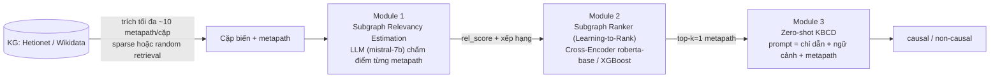

# Paths to Causality (KDD'25) - tóm tắt, giải thích và kiểm định (góc nhìn nghiên cứu)

> Nguồn: *Paths to Causality: Finding Informative Subgraphs Within Knowledge Graphs for Knowledge-Based Causal Discovery*,
> Susanti & Färber, KDD'25 · repo tác giả `susantiyuni/path-to-causality` (commit `6f9f701`).
> Mọi con số "của tôi" bên dưới đều được tính lại bằng code trong thư mục này (xem cột "Cách kiểm chứng").

## 1. Bài toán và động lực

* **Knowledge-based causal discovery (cặp biến)**: cho cặp (a, b) + (tuỳ chọn) câu ngữ cảnh, dự đoán `causal` / `non-causal` chỉ từ *metadata* (tên biến, văn bản) - không dùng dữ liệu quan sát.
* LLM đơn lẻ **không ổn định / hay ảo giác**. Ý tưởng: bơm **tri thức có cấu trúc từ Knowledge Graph (KG)** vào prompt.
* Khó khăn: giữa hai node có rất nhiều đường đi (ví dụ raloxifene-melanoma: 32 đường 1-hop, 1.031 đường 2-hop trong Hetionet) ⇒ không thể đưa hết vào prompt ⇒ cần **chọn đúng metapath "có ích" cho suy luận nhân quả**. Chọn theo độ giống vector (cách làm phổ biến trong QA/dialogue) được cho là chưa tối ưu.

## 2. Ý tưởng cốt lõi - 3 module

### Module 1 - Subgraph Relevancy Estimation (§4.2, App. C)
* Với mỗi (cặp, metapath m_i): đưa **một** metapath vào prompt, cho mistral-7b-instruct dự đoán nhãn. Metapath được coi là *relevant* nếu LLM đoán đúng nhãn người gán.
* Điểm liên quan (Eq. 1 trong bài): `s_i = 1 + p` nếu đoán đúng, `1 − p` nếu sai, với `p` = log-prob của token nhãn (beam transition score).
* Kết quả: danh sách metapath **xếp hạng** theo `s_i` (tối đa k=10/cặp) = dữ liệu huấn luyện cho Module 2 (chưng cất khả năng của LLM).
* **Trong thực nghiệm này: dùng thẳng file đã chấm điểm của tác giả** (`datasets/*/train_full.jsonl`, `test_truth.jsonl`). Code chấm điểm và code trích metapath từ Hetionet (Neo4j) / Wikidata (CLOCQ) **không được công bố** (README tác giả: một phần mã dùng thư viện độc quyền).

### Module 2 - Subgraph Ranker (§4.3, App. D)
* Bài toán Learning-to-Rank: query = cặp (a, b), "tài liệu" = metapath. Đầu vào cross-encoder: `[CLS] a b [SEP] type₁ v₁ - type₂ v₂ ...` (có node-type).
* Ba loss cho cross-encoder (allRank): **pointwise RMSE**, **pairwise RankNet**, **listwise ListNet**; mô hình `roberta-base`, 1 logit đầu ra.
* Phương án cổ điển: **XGBoost `rank:ndcg`** trên embedding trung bình của một **n-gram LM** nhỏ (n=2, dim=128) huấn luyện trên chuỗi "cặp + metapath" (Table D3: hist, `lambdarank_num_pair_per_sample=8`, `topk`).
* Siêu tham số code tác giả: AdamW lr 5e-5, 10 epoch, gradient accumulation 8, `neg_num=5`, max_len 500.
* Đánh giá độc lập: NDCG@5, Recall@5 (Table D2: ~55-57 / 71.43 trên COMAGC).

### Module 3 - Zero-shot KBCD (§4.4, App. E)
* Prompt: `x' = [I][x][M] The relation between [a] and [b] is` - chỉ dẫn, ngữ cảnh, top-k metapath (bài báo: **k=1** tốt nhất).
* Zero-shot, không huấn luyện LLM; LLM: mistral-7b-instruct, llama-3-8b-instruct, gemma-7b-it. Code tác giả: prompt **thô** (không chat template), greedy, `max_new_tokens=6`, rồi `verbalizer`.
* Baseline so sánh: no-subgraph, random, similarity (all-MiniLM-L6-v2 cosine), GPT-based (RankGPT, gpt-3.5), và 4 biến thể Subgraph Ranker (rmse / ranknet / listnet cross-encoder, XGBoost).

## 3. Kết quả chính trong bài (đọc từ Table 1-3)

| Quan sát (bài báo) | Số liệu |
|---|---|
| Subgraph > no-subgraph | cải thiện tới +44.4 F1 (COMAGC, llama-3-8b: 33.33 → 77.78) |
| Random subgraph vẫn hơn no-subgraph | trung bình +12.5 F1 |
| Subgraph Ranker vs similarity | +7.74 F1 trung bình |
| GPT-based thắng ranker ở đúng 1 trường hợp | COMAGC/mistral: 87.50 vs 83.87 (XGBoost) |
| Pairwise (RankNet) > pointwise > listwise | trong nhóm cross-encoder |
| SACHS (so với PC, A*, DirectLiNGAM) | F1 77.42 vs 44.00; Hamming 7 vs 24 |

## 4. Ánh xạ bài báo ↔ repo tác giả ↔ `My_experiments`

| Thành phần | Repo tác giả | My_experiments |
|---|---|---|
| Module 1 (dữ liệu chấm sẵn) | `datasets/<task>/{train_full,test_truth}.jsonl` | `m1_inspect_scored_data.py` (đọc + kiểm định, **không chấm lại**) |
| Module 1 độc lập (tự chấm điểm) | không công bố mã | `m1_score_metapaths.py` (LLM + log-prob → `rel_score`; xem README mục 3.2) |
| Module 2 cross-encoder | `src/ltr_nn.py`, `rank_loss.py`, `run_ltr.sh` | `m2_train_ranker.py --rankers ce_rmse ce_ranknet ce_listnet`, `lib/rankers.py` |
| Module 2 XGBoost | `src/ltr_xgboost.py` | `m2_train_ranker.py --rankers xgboost` (viết lại, sửa lỗi) |
| Module 2 đánh giá | `src/ltr_eval.py` (pytrec_eval) | `lib/metrics.py`, `m2_eval_ranked.py` |
| Module 3 | `src/instruct.py`, `zero_templatizer.py`, `llm.py`, `run_kbcd.sh` | `m3_zero_shot.py`, `lib/prompts.py`, `lib/llm.py`, `lib/selection.py` |
| no-subgraph | template `tnb`/`tca` | options `no_subgraph` (cặp+ngữ cảnh), `no_subgraph_pair` (chỉ cặp) |
| random | `subgraph_mode='random'` | option `random` (3 seed) |
| similarity | `datasets/*/test_sim.jsonl` | `similarity` (file tác giả), `similarity_recompute` (tự tính MiniLM) |
| GPT-based | `datasets/*/test_gpt_*.jsonl`, `rank_gpt.py` | `gpt` (file tác giả), `gpt_rerank` + `tools/rankgpt_rerank.py` (API của bạn) |
| Subgraph Ranker | `checkpoints/*/test_pred_*.jsonl` | `ranker:<tag>` (Module 2 của bạn), `authors_ranker:<tên>` (file tác giả) |

## 5. Phát hiện khi đọc code & dữ liệu (cần ghi vào báo cáo)

Tất cả đều có thể tái kiểm tra: `python m1_inspect_scored_data.py` và `python m2_eval_ranked.py --authors`.

1. **Công thức điểm trong dữ liệu ≠ Eq. (1) của bài.** Trên 12.623/12.623 metapath (train+test, 4 task): `rel_score = +1/|logp|` nếu LLM đoán đúng, `−1/|logp|` nếu sai (0 metapath khớp `1 ± logp`). Hệ quả: điểm là *độ tự tin* của LLM được gán dấu theo đúng/sai; scale rất rộng (−92 … +252 ở COMAGC) nên pointwise-RMSE trên giá trị thô nhạy với ngoại lai (tuỳ chọn `--target-transform signed_log`). Ví dụ trong chính Appendix C của bài: `relscore = 1.41565`, `probscore = −0.7063895` ⇒ 1/0.7063895 = 1.41565 (không phải 1 + p). Mã `src/llm.py::inference_with_score` của tác giả cho thấy `prob_score` là log-prob (chuẩn hoá log-softmax) của **token đầu tiên quyết định nhãn** (thuộc danh sách `non/false/no/...` hoặc `caus/aus/true/...`; không có thì lấy token đầu tiên) — `m1_score_metapaths.py --logp-mode authors` làm đúng như vậy.
2. **Cách tính NDCG của tác giả gán độ liên quan ngược.** `write_file(..., is_truth=True)` ghi `qrel = vị trí` (path tốt nhất = 1) và `pytrec_eval` coi số lớn = liên quan hơn ⇒ path tốt nhất có gain *thấp nhất*. Tôi mô phỏng lại và **khớp chính xác** NDCG@5 trong log của tác giả (vd 0.56595, 0.57115 trên COMAGC). Với cách tính đó:

   | COMAGC, NDCG@5 (paper-style) | oracle (xếp đúng hoàn hảo) | random (kỳ vọng) | reverse-oracle (xếp tệ nhất) | ranker tác giả |
   |---|---|---|---|---|
   | | **0.459** | 0.547 | **0.635** | 0.553 - 0.571 |

   ⇒ xếp hoàn hảo bị chấm *thấp hơn* xếp ngẫu nhiên; con số ~56 trong Table D2 tương đương mức **ngẫu nhiên**. Với SemEval, xếp ngược hoàn toàn đạt NDCG@5 = 1.0.
3. **Recall@5 là hằng số, không phụ thuộc ranker**: mọi path đều "relevant" ⇒ `Recall@5 = min(5, n)/n` = 5/7 = 71.43 (COMAGC), ≈72.2 (ADE), 100 (SEMEVAL) - đúng bằng Table D2.
4. **Với cách tính đã sửa** (path tốt nhất gain cao nhất; `lib/metrics.py::corrected_ranking_eval`), ranker tác giả đã công bố **không vượt ngẫu nhiên** khi tái tạo thứ tự của Module 1 trong 5 path đầu:

   | COMAGC | Top-1 trùng oracle | Vị trí oracle trung bình của top-1 (ngẫu nhiên = 3.0) | NDCG@5 (random 0.861) |
   |---|---|---|---|
   | RoBERTa-RMSE / RankNet / ListNet | 5.9% / 5.9% / 11.8% | 3.65 / 3.74 / 3.26 | 0.831 / 0.823 / 0.851 |
   | XGBoost | 11.8% | 3.24 | 0.852 |
   | RankGPT (gpt-3.5, file tác giả) | **35.3%** | **2.47** | **0.914** |

   Giả thuyết (chưa kiểm chứng) giải thích: tác giả **chọn epoch tốt nhất theo NDCG@5 trên chính tập test** (`ltr_nn.py`) - với metric ngược này điều đó ưu tiên ranker xếp *ngược*. Code của tôi chọn epoch trên tập dev tách từ train (`--select-on-test` để tái hiện).
5. **Pool `oracle_top5` bị lọc bằng nhãn.** `test_truth` đã sắp theo `rel_score` (phụ thuộc nhãn đúng/sai) và tác giả chỉ xếp lại 5 path đầu ⇒ ứng viên được chọn từ tập đã "biết nhãn". Mức rò rỉ đo được: tỉ lệ "LLM đoán đúng khi dùng path" giữa path *được giữ* và *bị loại* là 0.688 vs 0.676 (COMAGC), 0.543 vs 0.522 (GENEC) - nhỏ, nhưng 0.473 vs 0.311 (ADE) - đáng kể. Tuỳ chọn `--pool all` xếp tất cả ứng viên, không rò rỉ.
6. **RankGPT nhìn thấy thứ tự oracle.** `ltr_gpt.py` đưa path cho GPT theo thứ tự `test_truth` (tốt nhất đứng đầu). `tools/rankgpt_rerank.py` mặc định **xáo ngẫu nhiên** trước khi đưa cho GPT.
7. **Tập test rất nhỏ** (COMAGC 34, ADE 38, GENEC 35, SEMEVAL 24 cặp; khớp Recall 47.06 = 8/17 trong Table 1). Một mẫu đổi ≈ 2.6-4.2 điểm accuracy và 3-6 điểm F1; ADE **toàn mẫu dương** ⇒ Precision luôn 100. Kết luận "A hơn B 2-5 điểm F1" chưa có ý nghĩa thống kê ⇒ nên chạy nhiều LLM/nhiều seed random, và báo cáo cả khoảng dao động.
8. **`verbalizer` gốc kiểm tra chuỗi con `no` trước** ⇒ câu trả lời kiểu `"causal. Knowledge..."` bị tính là non-causal (`knowledge` chứa `no`). Tôi lưu output thô và báo cả hai: `F1_authors_verbalizer` (y nguyên) và F1 với parser lấy nhãn xuất hiện sớm nhất (`lib/prompts.py`).
9. **Code XGBoost gốc có lỗi:** nhãn = vị trí (0 = tốt nhất) trong khi XGBRanker coi nhãn lớn = tốt hơn; lập chỉ mục `all_emb[all_qid]` theo qid thay vì theo hàng; biến toàn cục. n-gram LM huấn luyện batch=1 (chậm). Bản của tôi: nhãn `m − vị_trí`, qid liên tục, n-gram mini-batch.
10. **Baseline similarity:** `test_sim.jsonl` có **pool ứng viên khác** `test_truth` (trùng stops chỉ ≈23-26% ở 3 task y sinh) nên không so NDCG được, chỉ so F1. Công thức `sim_score` **tái lập chính xác (sai số 0.0000)** cho COMAGC/ADE/GENEC bằng `cos(MiniLM("e1 e2"), MiniLM(stops nối bằng khoảng trắng))`; **không tái lập được cho SemEval** (Wikidata).
11. **Một số file trong repo không chạy được nguyên trạng**: `instruct_gpt.py` thụt lề sai & import `llm_gpt` không có; `ltr_gpt.py` import `credentials` không có; `requirements.txt` ghim `torch==1.13.1`, `numpy==1.21.2` (cũ). Vì vậy `My_experiments` viết lại thay vì gọi code gốc.

## 6. Hệ quả cho thiết kế thực nghiệm này

* Module 2 báo **cả hai** cách tính (`paper_style_*` để đối chiếu Table D2, `corrected_*` để đánh giá thật) cùng các điểm tham chiếu oracle/random.
* Module 3 chạy **hai protocol**: `oracle_top5` (giống tác giả, để so với bài) và `all` (không rò rỉ nhãn) - bạn nên báo cáo cả hai.
* Mọi output LLM lưu thô (`predictions.jsonl`) để tính lại metric/verbalizer bất kỳ lúc nào mà không cần gọi lại LLM.

